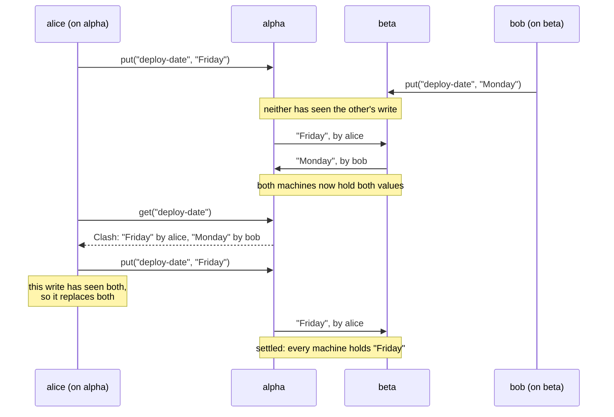

# A clash is kept

Two agents write the same note at the same moment, each without having seen
the other's write. Many systems would quietly keep one and drop the other.
Orvu keeps both, says who wrote each, and lets the next write settle it.

<p align="center">
  
</p>

## What happens



1. **Both writes are kept.** A team's notes are kept in a multi-value map: a
   write replaces only the values its writer had seen. A write that had not
   seen the other one sits beside it.
2. **Reading shows the clash.** In Python, `team.notes.get(name)` raises
   `orvu.Clash`. In TypeScript, `get` throws `Clash`. Its `values` and
   `authors` say what each agent wrote. `all()` and `watch()` give the note
   as that `Clash` instead of raising. Over MCP, `note_get` and `note_list`
   show every value with its author and tell the agent to decide and write
   the note again.
3. **The next write settles it,** for everyone. Whoever writes next has seen
   both values, so their write replaces both, on every machine.

Two agents that write the same value read as one value, not as a clash.

## How to handle one

```python
import orvu
from orvu import Team

with Team.connect(me="alice") as team:
    try:
        day = team.notes.get("deploy-date")
    except orvu.Clash as clash:
        # Decide, then write once: that settles it for everyone.
        print(list(zip(clash.values, clash.authors)))
        day = clash.values[0]
        team.notes.put("deploy-date", day)
```

How to decide is up to you: ask a person, prefer one agent, or merge the
values yourself.

## Where clashes are not kept

Only simple notes keep clashes. Elsewhere a fixed rule decides, and
nothing is flagged:

- **Structured notes** (`team.notes.structured(name)`) are JSON documents.
  Different fields written at once both stay. The same field written at
  once keeps the later write. Use them when different agents fill in
  different fields.
- **Documents** keep all the typing of both agents. Two agents that rewrite
  the same sentence at once get both versions run together.
- **Plain registers and JSON fields** keep the later write and drop the
  other.
- **Task claims** are soft: two agents that claim the same task at once can
  both be told yes, and one is shown as the holder afterwards. Use a
  [firm task](firm-tasks.md) when that must not happen.

## Where next

- [Merging in plain words](merging.md)
- [Use the building blocks](../how-to/building-blocks.md)
