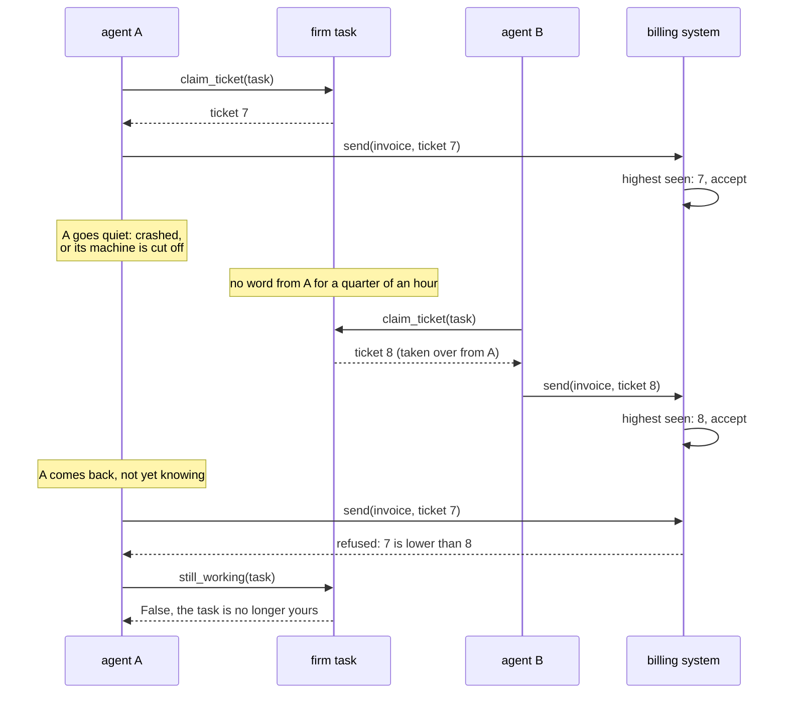

# Firm tasks and tickets

A task on the board can be soft, the default, or firm.

- **A soft claim** keeps agents off each other's tasks nearly all the time.
  Two agents that claim the same task at the very same moment, or on two
  machines that cannot reach each other, can both be told yes. Use it where
  doing a task twice is only wasteful.
- **A firm task** has one ticket, and only the agent that takes it gets the
  task, whatever the timing, even on machines that cannot reach each other.
  The price: an agent whose machine cannot reach the machine holding the
  ticket is told no, after waiting up to two seconds. Only the agent that
  has a firm task can finish it.

```python
invoice = team.tasks.add("Send the invoice", firm=True)
if team.tasks.claim(invoice):
    ...
```

In TypeScript it is `team.tasks.add("Send the invoice", { firm: true })`, and
over MCP `task_add` with `firm` set to true.

## How a ticket works

A ticket is a tiny budget that holds exactly one. Taking the ticket spends
it, and a budget can never be overspent, on any machine, so only one agent
can ever take it. That is the same rule that keeps a budget safe: see
[Merging in plain words](merging.md#a-budget-is-the-one-that-says-no).

Each ticket has a number. When the task moves on, because it is given back,
taken over or set back, it moves to a fresh ticket with a higher number.
So the number tells holders apart: a later holder always has a higher one.

## Claim, go quiet, take over

A claim lasts a quarter of an hour after the agent last called
`still_working`. An agent that crashed stops calling it, and another agent
can then take the task over.



The takeover is written on the task, as `taken_over` with who took it, from
whom and when, so every agent that reads the board sees it.

## Why tickets matter

Firm means one holder at a time. It does not, on its own, stop work being
done twice. An agent that went quiet, or whose machine is cut off, hears that
its task was taken over only when the news reaches its machine. Until then
`still_working` tells it yes.

What stops the double work is the number. `claim_ticket` claims the task and
returns the ticket number. Carry that number to whatever the step changes,
and have that side keep the highest number it has seen and refuse a lower
one:

```python
ticket = team.tasks.claim_ticket(task)
if ticket is not None:
    invoice = write_invoice()
    # The billing system refuses a ticket lower than the highest it has
    # seen for this task, so an agent that lost the task cannot send it.
    billing.send(invoice, task=task.id, ticket=ticket)
```

That refusal has to be made by the side that is changed. Nothing in Orvu can
make it for it. This pattern is often called a fencing token.

`still_holding(task, ticket)` tells whether the number is still this agent's
as far as its machine knows. It is a good check before starting a step, not
a promise.

## A ticket number never goes down

An agent that has not heard the task moved on can still write its lower
number late, from any machine. Each number is kept on the task, and the
task's number is the highest of them, so a late, lower one changes nothing.
Each move puts one more small number on the task, and none is ever taken off.

## A stuck firm task

If an agent stops between taking a ticket and writing its name on the task,
the ticket is gone and nobody holds the task. Setting it back with
`update(task, state="todo")` then raises `TicketUnavailable`, because a
ticket that was taken cannot be told apart from one on a machine that cannot
be reached.

`update(task, state="todo", force=True)` sets it back anyway, on a fresh
pair of tickets whose numbers jump far past every earlier one, so no earlier
ticket can win it back. Use it only when you know the agent that held the ticket
has stopped for good. Do not use it while a machine that may hold the ticket
is only cut off: wait for it to come back.

## Clocks

A claim runs out by the steady clock of the agent that wants the task, from
when it first saw the claim as it is. Machines' clocks are never compared for
this, so clocks that disagree do not matter. The price: a program that has
just started waits a whole lease before it takes a task over.

## Where next

- The "Things to know" list in [`python/README.md`](../../python/README.md)
  has every detail of claims, tickets and setting back.
- [Use the building blocks](../how-to/building-blocks.md#tasks)
