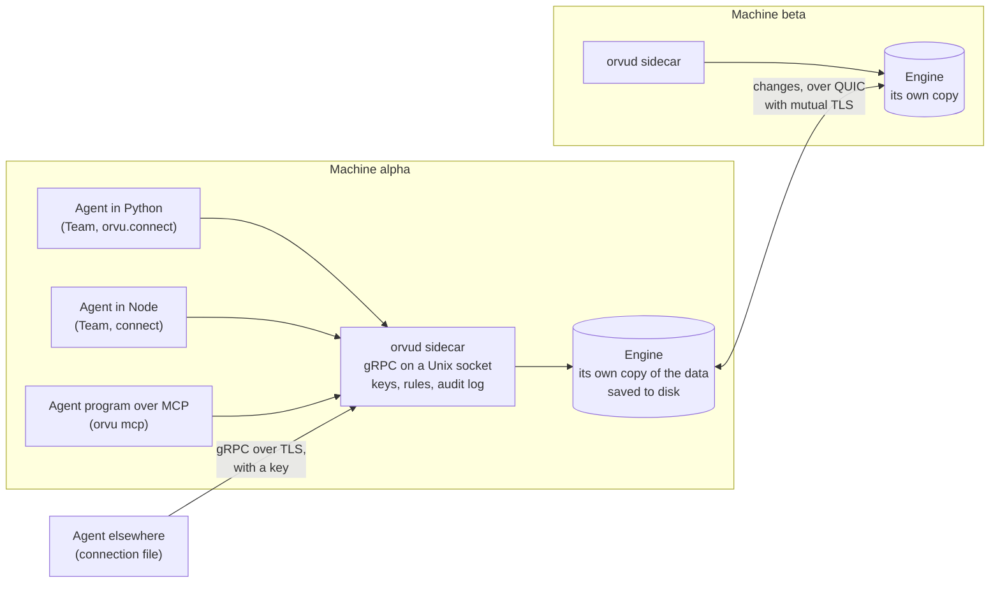
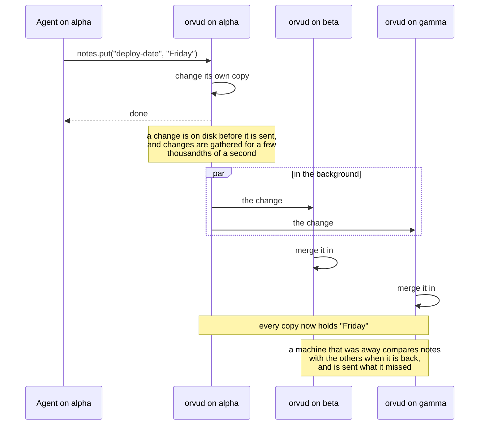

# How it works

Orvu has four layers. An agent talks to a library, the library talks to a
sidecar on the same machine, the sidecar runs the engine, and the engines on
different machines keep each other in step.

## The pieces

**The agent** is any program of yours, or an agent program such as Claude
Code. It uses the team's building blocks: notes, tasks, budgets, documents,
an inbox, tallies, a roster and search.

**The library** is the Python or TypeScript package. `Team` turns the
building blocks into calls on plain shared objects, such as a map of notes
or a counter that cannot go below zero. The library finds the sidecar, and
starts it if it is not running. `orvu mcp` is built on the Python library:
it turns the building blocks into MCP tools.

**The sidecar**, `orvud`, is a small background program. It runs the engine
and answers requests over gRPC on a Unix socket that only its own user can
open. With `--network`, it also answers agents on other machines and in
containers, over TLS, and only those with a key. It checks each agent's key
and rules, and records every change in an audit log. One sidecar runs one
engine and serves one namespace. Its requests are defined in one file,
[`dataplane.proto`](../../crates/orvud/proto/orvu/v1/dataplane.proto), so a
client in another language can be generated from it.

**The engine** holds this machine's copy of every shared object. A change is
made to the local copy at once, saved to disk, and then sent to the other
machines in the background. The engine is written in Rust and is split into
the [modules](../reference/modules.md) of this repository.

**Other machines** each run a sidecar of their own, with their own copy.
They reach each other over QUIC, and each shows the others a certificate
signed by the same key, so a machine without one is turned away.
`orvud setup` makes those certificates.

## How a write spreads

The agent gets its answer as soon as its own machine has the change. It does
not wait for the other machines. They usually have it within a few
thousandths of a second on one computer, plus the time the network takes
([measurements](../../python/MEASUREMENTS.md)).

A machine that cannot reach the others keeps working on its own copy. What
it wrote reaches them when the link is back, and the copies end up the same.
That is what the data types are built for: see
[Merging in plain words](merging.md).

## One team, one sidecar per machine

Out of the box, `Team.connect()` uses a sidecar that keeps its data on this
machine and shares it with nobody: the local sidecar, started for you. A
team that lives on several machines runs one sidecar per machine, started
from a settings file that `orvud setup` makes, by hand or by systemd. A
program reaches that sidecar by its socket. See
[Run one team on several machines](../how-to/several-machines.md).

## Where next

- [Merging in plain words](merging.md)
- [Saving and syncing](saving-and-syncing.md)
- [`crates/orvud`](../../crates/orvud), the sidecar in detail
