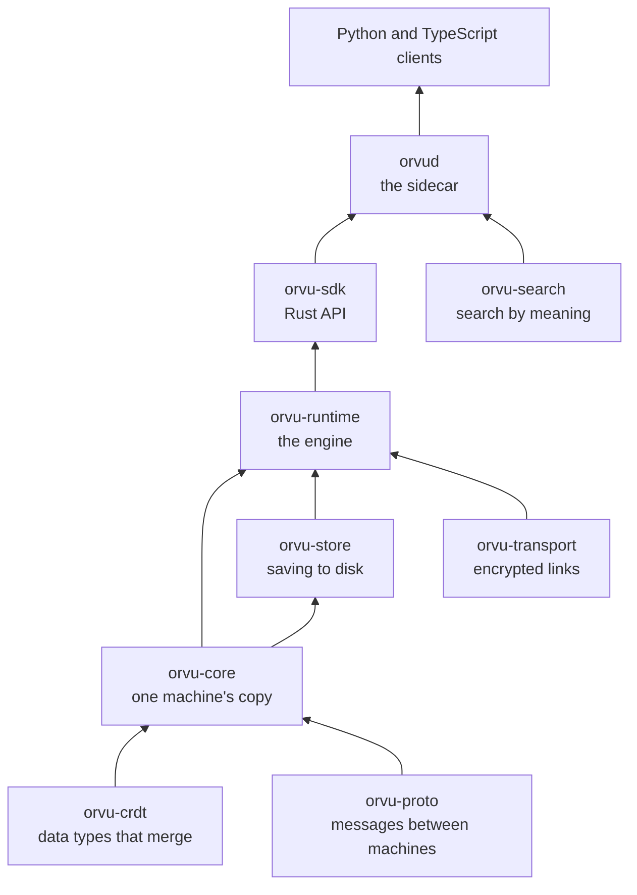

# Modules

The engine is written in Rust and split into crates. Each has a `README.md`
that is its reference, and the Rust examples in each are run as tests.

| Crate | What it does |
|---|---|
| [`orvu-crdt`](../../crates/orvu-crdt) | The data types that can merge. No networking, no disk |
| [`orvu-proto`](../../crates/orvu-proto) | The messages machines send each other, from `.proto` files |
| [`orvu-core`](../../crates/orvu-core) | One machine's copy of the data, and turning changes into messages and back |
| [`orvu-store`](../../crates/orvu-store) | Saving to disk, in redb |
| [`orvu-transport`](../../crates/orvu-transport) | Links between machines, over QUIC with mutual TLS |
| [`orvu-runtime`](../../crates/orvu-runtime) | The engine: sends, receives, saves and catches up |
| [`orvu-sdk`](../../crates/orvu-sdk) | The friendly Rust API, and the settings file it reads |
| [`orvu-search`](../../crates/orvu-search) | The model and index behind search by meaning |
| [`orvud`](../../crates/orvud) | The sidecar, its gRPC service and its commands |
| [`orvu-test-support`](../../crates/orvu-test-support) | Helpers for tests only |

## Using Orvu from Rust

The [`orvu-sdk`](../../crates/orvu-sdk) crate runs the engine inside your
program, with no sidecar. You start a client, open a counter or a document
by name, and call ordinary methods on it.

## Using Orvu from another language

Generate a gRPC client from
[`dataplane.proto`](../../crates/orvud/proto/orvu/v1/dataplane.proto) and
talk to `orvud` over its socket. The service has four calls: `Open`,
`Execute`, `Batch` and `Watch`. The "Talk to it" part of the
[`orvud` README](../../crates/orvud) shows how.

## Conformance cases

[`conformance`](../../conformance) holds test cases for the data types that
any other implementation of them must also pass.
